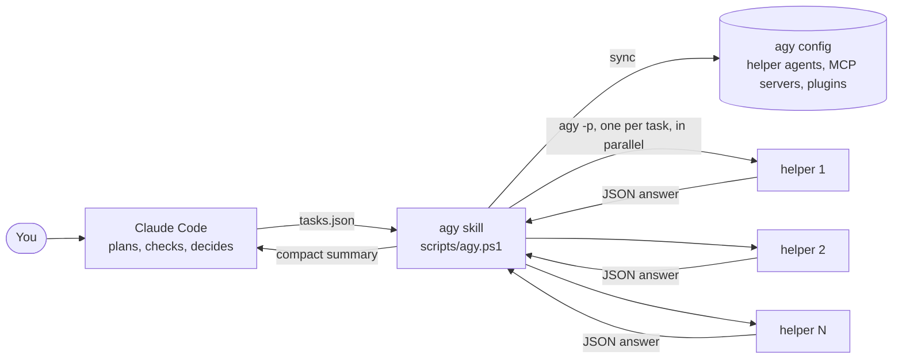

<div align="center">

# agy helpers for Claude Code

**Give Claude Code a team of fast Gemini helpers for side tasks, while Claude stays in charge.**

[](https://github.com/Mhrnqaruni/claude-code-agy-helpers/actions/workflows/ci.yml)
[](LICENSE)


</div>

This is a [Claude Code](https://code.claude.com/docs) skill that turns Google's **agy** (the [Antigravity CLI](https://antigravity.google)) into a pool of parallel helper agents. Claude splits off independent side tasks, such as web research, fact-checks, file summaries or test runs. agy runs them side by side on **Gemini 3.8 Flash High**. Each helper sends back a short, structured answer with its sources and a confidence level, and Claude checks it before relying on it.

Why it helps:

- **Fast research.** agy's Google-backed web search takes seconds. Six helpers finished a mixed batch in one to two minutes in our tests.
- **Light on Claude.** Claude only reads a compact summary, about 1,100 tokens for six helpers. The helpers' own work runs on your Google plan, not your Claude usage.
- **Same tools as Claude.** Every run copies your Claude Code MCP servers and plugins into agy, so helpers can use them too.
- **Safe by default.** Each helper gets only the permissions its task needs, and the whole design is covered by tests.

> Community project. Not affiliated with Anthropic or Google.

## Contents

- [Quick start](#quick-start)
- [How it works](#how-it-works)
- [Task file and commands](#task-file-and-commands)
- [Performance and cost](#performance-and-cost)
- [Testing](#testing)
- [Troubleshooting](#troubleshooting)
- [Limitations](#limitations)
- [Contributing](#contributing) and [License](#license)

---

## Quick start

### 1. What you need

| Requirement | How to get it |
|---|---|
| **Claude Code** | See the [Claude Code docs](https://code.claude.com/docs) |
| **agy** (Antigravity CLI) | Install it from [antigravity.google](https://antigravity.google), then run `agy` once in a terminal to sign in |
| **PowerShell 7** (`pwsh`) | Windows: `winget install --id Microsoft.PowerShell`. macOS and Linux: [Microsoft's install guide](https://learn.microsoft.com/powershell/scripting/install/installing-powershell) |
| **Git** | To clone this repository |

### 2. Install

```bash
git clone https://github.com/Mhrnqaruni/claude-code-agy-helpers.git
cd claude-code-agy-helpers
pwsh ./install.ps1
```

The installer copies the skill into `~/.claude/skills/agy`, sets up agy, and runs a ten-second test task. When it prints `All set`, you are ready.

### 3. Use it

Open Claude Code and ask in plain words:

> Use agy helpers to find the latest stable versions of React, Vue, Svelte and Angular, with release dates and official sources.

> Use agy helpers to summarize each Markdown file in the docs folder in three bullets.

> Ask agy for a second opinion on this migration plan.

You can also type `/agy` followed by a task. Claude writes a task list, runs the helpers in parallel, checks what comes back and gives you the result.

### What Claude gets back

```text
agy helpers on Gemini 3.8 Flash (High): 6 task(s), 6 ok, 0 failed, 60s, 231,619 agy tokens

[ok] python-latest  (59s, 112,411 agy tokens, conversation ae2e96b2-...)
    The latest stable Python release is Python 3.15.2, released on October 25, 2026.
    confidence: high | sources: https://www.python.org/downloads/release/python-3152/ (published 2026-10-25)

[ok] node-version  (19s, 12,133 agy tokens, conversation 5bd94e0f-...)
    The installed Node.js version is v24.13.0.
    confidence: high
```

### When to use it

| Good jobs for helpers | Keep with Claude |
|---|---|
| Web research on several topics at once | Architecture and design decisions |
| Checking a list of claims, versions or links | Judgment calls without a clear answer |
| Summarizing or reviewing many files | Final answers |
| A second opinion on a plan or a diff | Quick lookups of one or two steps |
| Running approved tests or linters in several folders | Risky actions that can't be checked |

### Update or remove

```bash
git pull && pwsh ./install.ps1    # update to the latest version
pwsh ./install.ps1 -Uninstall     # remove the skill and everything it added to agy
```

To install the skill into a single project instead of for your user, run `pwsh ./install.ps1 -Project <path-to-project>`.

---

## How it works

### Architecture



Claude stays the lead: it decides what to delegate and reviews the results. The skill's script does the plumbing. It keeps agy in sync with Claude Code, starts one headless agy process per task, gives each one only the permissions its task needs, and condenses the answers.

### What happens during a run

1. **Sync.** The script installs or refreshes three helper agents in `~/.gemini/config/agents/`. It merges Claude Code's MCP servers into agy's `~/.gemini/config/mcp_config.json`, and imports Claude Code plugins with `agy plugin import claude` when they change.
2. **Prepare.** Each task gets its own folder under the system temp folder (`agy-runs/<timestamp>/<task>`). The folder holds the task's context files, a permissions file (`agy-settings.json`) and the full prompt. The prompt starts with a short header: the task id, today's date, what the helper may access, and the answer format.
3. **Launch.** Up to `-MaxParallel` agy processes run at once (6 by default, 20 at most). Each one gets a time limit, and a stuck process is stopped 45 seconds after its limit.
4. **Collect.** The script reads agy's JSON result: the structured answer, refused actions, why it stopped, and token usage. Raw output is saved in the task folder. A run that fails for no clear reason is retried once.
5. **Report.** It writes `results.json` for the batch and prints the compact summary that Claude reads. The exit code is 0 when every task succeeded.

Each helper is started like this:

```text
agy -p "<header + task>" --agent claude-helper --model gemini-3.8-flash-high
    --output-format json --json-schema skills/agy/schemas/answer.json
    --settings <run>/<task>/agy-settings.json --print-timeout 300s
    [--add-dir <folder> ...] [--mode accept-edits]
```

### Helper agents

agy reads custom agents from `~/.gemini/config/agents/`. The skill installs three, each with a fixed tool list. None has browser, subagent or image tools, so helpers can't open windows or start more agents.

| Agent | Used for | Tools |
|---|---|---|
| `claude-helper` | `read` tasks | `search_web`, `read_url_content`, `view_file`, `list_dir`, `find_by_name`, `grep_search`, `finish` |
| `claude-helper-cmd` | `commands` tasks | the above, plus `run_command`, `command_status` |
| `claude-helper-edit` | `edit` tasks | the above, plus `write_to_file`, `replace_file_content`, `multi_replace_file_content` |

All three have `subagent: false`, so agy's own agents never call them. MCP tools are available to all three when a task allows MCP.

`finish` matters. With `--json-schema`, agy returns the structured answer through its `finish` tool. Without it, the model kept repeating its answer until it was stopped. In testing, that cost four times the tokens and twice the time.

### Permissions

Headless agy can't ask anyone for approval. Any action that needs approval is refused, and the run then ends with an empty answer. So each task gets an exact allow list through `--settings`, which only applies to that run:

| Task option | Permission it adds |
|---|---|
| `web: on` (default) | `read_url(*)`, to open web pages. Web search itself needs no rule |
| `mcp: on` (default) | `mcp(*)`, to call MCP tools |
| `allowCommands: ["npm test"]` | `command(npm test)`, for that exact command text only |
| `access: edit` | `--mode accept-edits`, to create and edit files in the task's folder |

Rule formats we tested with agy 1.4.12:

| Rule | Result |
|---|---|
| `command(npm test)` | Works: exactly that command |
| `read_url(*)` and `read_url(example.com)` | Work: any page, or one domain |
| `mcp(*)` and `mcp(server/tool)` | Work: all MCP tools, or one tool |
| `mcp(server)` | Does not work |

The skill never uses `--dangerously-skip-permissions`.

### MCP servers and plugins

agy has no per-folder MCP configuration, only a global file. On every run, and when you call `sync`, the script works out which MCP servers Claude Code would use in the current project and writes them into `~/.gemini/config/mcp_config.json`:

- **Sources:** user-scope servers in `~/.claude.json`, that project's entry in `~/.claude.json`, and the project's `.mcp.json` servers that you approved in Claude Code (`enabledMcpjsonServers` or `enableAllProjectMcpServers`, minus `disabledMcpjsonServers`).
- **Conversion:** `${VAR}` and `${VAR:-default}` placeholders are filled from the environment. On Windows, `npx`, `npm`, `pnpm`, `yarn` and `bunx` commands are wrapped in `cmd /c`.
- **Bookkeeping:** synced server names are tracked in `~/.gemini/config/claude-sync-state.json`. A server you remove from Claude Code is removed from agy. Servers you added to agy yourself are never touched.
- **Plugins:** when `~/.claude/plugins/installed_plugins.json` changes, the script runs `agy plugin import claude`. That brings over the skills, agents, rules and MCP servers inside your Claude Code plugins.
- **Optional (not covered by the tests yet):** `sync -ShareClaudeSkills` points agy at `~/.claude/skills` (excluding this skill), so helpers can use your personal skills.
- **Not shareable:** legacy SSE servers (agy only speaks stdio and streamable HTTP), servers that sign in with OAuth inside Claude Code (sign in again in agy), and the claude.ai connectors of the Claude desktop app.

### Answers

By default each helper must answer in this shape (`skills/agy/schemas/answer.json`):

| Field | Meaning |
|---|---|
| `status` | `done`, `partial` or `blocked` |
| `answer` | The result, short and specific |
| `sources` | URLs with publication dates, or file paths |
| `confidence` | `high`, `medium` or `low` |
| `notes` | Caveats, or what is missing |

Use `"schema": "none"` for plain text, or point `schema` at your own JSON schema.

### Follow-ups

Every helper keeps its own conversation. `followup -Conversation <id> -Message "..."` continues it with the same agent, permissions and folders. When resuming a conversation, agy reports token usage for the whole conversation. The script subtracts the earlier turns, so the summary shows only the new turn.

---

## Task file and commands

### Task file

```json
{
  "defaults": { "addDirs": ["C:/code/my-app"], "timeoutSec": 300 },
  "tasks": [
    { "id": "react", "prompt": "Find the latest stable React release and its release date. Use the official source." },
    { "id": "spec", "prompt": "Summarize the spec in five bullets.", "files": ["C:/code/my-app/spec.md"], "web": "off" },
    { "id": "tests", "prompt": "Run the unit tests and list each failing test.", "access": "commands",
      "allowCommands": ["npm test"], "workDir": "C:/code/my-app" }
  ]
}
```

| Field | Default | Meaning |
|---|---|---|
| `id` | `task1`, `task2`, ... | Short name. Also the task's folder name |
| `prompt` | required | The task. It must stand on its own: the helper sees nothing else |
| `access` | `read` | `read`, `commands` or `edit` (see [Permissions](#permissions)) |
| `allowCommands` | none | Exact commands the helper may run |
| `workDir` | its own temp folder | Folder it works in. Commands run there, and `edit` writes there |
| `addDirs` | none | Extra folders it may read |
| `files` | none | Files copied into its `context` folder |
| `web` | `on` | Web search and web pages |
| `mcp` | `on` | MCP tools |
| `schema` | default answer schema | A JSON schema file, or `"none"` |
| `timeoutSec` | 300 | Time limit for this helper |

Put shared options in `defaults`. Values set in a task win over `defaults`. List options (`allowCommands`, `addDirs`, `files`) are merged. A bigger example is in [`examples/tasks.example.json`](examples/tasks.example.json).

### Commands

Claude runs these for you, but you can run them yourself too:

```bash
pwsh ~/.claude/skills/agy/scripts/agy.ps1 <command> [options]
```

| Command | What it does | Options |
|---|---|---|
| `run` | Runs a batch (`-TasksFile`) or one task (`-Prompt`) | `-Id`, `-Access`, `-AllowCommands`, `-AddDir`, `-Files`, `-WorkDir`, `-Web`, `-Mcp`, `-Schema`, `-MaxParallel`, `-TimeoutSec`, `-Retries`, `-AnswerChars`, `-OutDir`, `-ProjectDir` |
| `followup` | Continues one helper's conversation | `-Conversation`, `-Message`, `-TimeoutSec` |
| `sync` | Installs the helper agents, then syncs MCP servers and plugins into agy | `-ProjectDir`, `-Force`, `-ShareClaudeSkills` |
| `doctor` | Checks agy, the model, the helper agents and the MCP servers | `-Smoke` also runs a tiny task |
| `clean` | Deletes run folders older than N days | `-OlderThanDays` (default 7) |

On the command line, `-AllowCommands`, `-AddDir` and `-Files` take `;`-separated lists. Command-line options apply to every task in a batch.

### Output

- **Summary** (what Claude reads): one entry per task with `ok` or `FAILED`, time, agy tokens, conversation id, a shortened answer (600 characters by default, set with `-AnswerChars`), confidence and sources. For `commands` and `edit` tasks it also shows the folder, so Claude can look at changed files.
- **`results.json`**: everything, including the full answers, refused actions, why each run stopped, and hints for failures.
- **Task folders**: `prompt.txt`, `agy-settings.json`, the raw agy output and stderr, `task.json` (used by `followup`), and the `context` folder.

### Configuration

| Setting | Default | Meaning |
|---|---|---|
| `AGY_HELPER_MODEL` environment variable | `gemini-3.8-flash-high` | agy model for the helpers (see `agy models`) |
| `-MaxParallel` | 6 | Helpers running at once, up to 20 |
| `-TimeoutSec` | 300 | Time limit per helper |
| `-Retries` | 1 | Retries for runs that fail without a clear reason |

---

## Performance and cost

Measured on Windows 10 with agy 1.4.12, November 2026:

| Run | Time | agy tokens |
|---|---|---|
| Smoke test, one tiny task | 7 s | 4.8k |
| Six helpers in parallel: research, file summary, MCP call, command, file edit, folder read | 60 s and 104 s (two runs) | 232k and 243k |
| One research helper | 59 to 104 s | 112k to 130k |
| One MCP call, command or file edit | 19 to 35 s | 12k to 24k |
| Follow-up to one helper | 15 to 18 s | 9k, or 88k when it searched the web again |
| The same six helpers before the `finish` fix | 137 s | 975k |

What this means in practice:

- **Claude's side stays small.** One step starts the whole batch, and Claude only reads the summary: about 4,500 characters (around 1,100 tokens) for six helpers. The helpers' searching and reading never enters Claude's context.
- **agy's side uses more tokens than you might expect.** agy doesn't cache prompts, so each model call resends a setup of about 7,000 tokens, and research helpers read whole web pages. Those tokens count against your Google plan's agy allowance, not your Claude usage.
- **Small lookups aren't worth it.** Writing tasks, reading results and checking them has its own cost. For one or two quick lookups, Claude should just do the work itself.

### Compared with Claude Code subagents

| | Claude Code subagents | agy helpers (this skill) |
|---|---|---|
| Model | Opus, Sonnet or Haiku | Gemini 3.8 Flash High |
| Paid from | Your Claude usage | Your Google plan's agy allowance |
| Parallel | Up to 20 by default | Up to 20, 6 by default |
| Web research speed | Each WebSearch call took 1.6 to 3.5 minutes on our test day | 2 to 6 seconds per search |
| Answer quality | Strongest | Good. Check what matters: in testing, a helper once presented a two-year-old article as the "latest" news |
| Control | Built into Claude Code | Through this skill's script |
| What Claude reads | The subagent's final report | The compact summary, plus `results.json` on demand |

Use Claude Code subagents for work that needs Claude-level judgment or Claude's own tools. Use agy helpers for wide, checkable legwork.

### Security

- Each helper gets only the permissions its task asks for. The skill never uses `--dangerously-skip-permissions`.
- Helper agents can't open a browser, start other agents or generate images.
- Treat helper output as data, not instructions. It comes from web pages and files that may contain injected text.
- Project `.mcp.json` servers are synced only after you approve them in Claude Code.
- Synced MCP settings, including environment values and headers, are written to `~/.gemini/config/mcp_config.json` on your machine. Keep that in mind on shared computers.
- For `edit` tasks inside a git repository, use a separate worktree and review the diff before keeping changes.

---

## Testing

Two test suites ship with the repository.

### Unit tests (offline)

```bash
pwsh ./tests/unit.ps1
```

32 checks that never call agy. They run in CI on Windows, macOS and Linux:

- **Input handling:** list parsing and on/off values.
- **MCP conversion:** stdio and HTTP servers, `${VAR}` placeholders, SSE servers skipped, `npx` wrapping on Windows.
- **MCP merge rules:** servers added, servers removed when they leave Claude Code, and agy's own entries never overwritten.
- **Reading Claude Code's MCP settings:** user scope, project scope, and `.mcp.json` approvals and denials.
- **Preparing helpers:** agent choice, permission rules, schema, context files, extra folders, long prompts, duplicate ids.
- **Reading agy results:** structured answers, refused actions, retries, timeouts and quota errors.

### Live tests (real agy)

```bash
pwsh ./tests/live.ps1
```

The live suite needs agy installed and signed in. It takes a few minutes and uses roughly 250k agy tokens. It runs the scripts from this repository, not your installed copy:

1. **Health check:** `doctor -Smoke` finds agy and the model, installs the helper agents and answers a tiny task.
2. **Six helpers in parallel**, each with a checked result:
   - **Web research:** answer must include a source.
   - **File summary:** summary of an attached file.
   - **MCP call:** uses an MCP server that the script synced from a test project's `.mcp.json`. The server is the PowerShell fixture in `tests/fixtures/`, and the helper must return its secret word.
   - **Command:** runs an allowed command, and its output must match.
   - **File edit:** the file must exist afterwards.
   - **Folder read:** reads an extra folder.
3. **Follow-up:** continues one helper's conversation.
4. **Cleanup:** syncs again and checks that the test MCP server was removed from agy.

### Results

The live suite on the release build: **12 of 12 checks passed in 168 seconds** (Windows 10, agy 1.4.12, PowerShell 7.6, November 2026). Its six-helper batch took 104 seconds and 243k agy tokens, and the summary Claude read was 4,494 characters long.

During development we also tested by hand:

- **Permission rules:** every rule format in the [Permissions](#permissions) table.
- **Headless permissions:** that headless mode refuses actions that need approval.
- **`--json-schema`:** it returns a `structured_output` object.
- **Edits:** `--mode accept-edits` lets helpers create files.
- **Sandbox:** `--mode auto` and `--sandbox` are not available on Windows.
- **The `finish` bug:** its fix is described under [Helper agents](#helper-agents).

---

## Troubleshooting

| Message or problem | What to do |
|---|---|
| `agy was not found` | Install agy and make sure `agy` runs in a new terminal |
| `model: ... NOT available` | Run `agy models`. Sign in again, or check that your plan includes the model |
| `needs a command permission` | Add the exact command to `allowCommands` |
| `needs web page access` or `needs MCP access` | Set `web` or `mcp` to `on` for that task |
| `timed out` | Raise `timeoutSec`, or split the task |
| `agy is not signed in` | Run `agy` once in a terminal and sign in |
| `quota or rate limit` | Wait, then rerun with a lower `-MaxParallel` |
| `empty answer` | Rerun once. If it repeats, make the prompt simpler and more specific |
| Scripts blocked on Windows after downloading the ZIP | Run `Get-ChildItem -Recurse \| Unblock-File` in the repository folder, or clone with git instead |
| Helpers don't see an MCP server | Run `pwsh ~/.claude/skills/agy/scripts/agy.ps1 doctor` from the project folder and check the server list |

---

## Limitations

- **Tested platforms:** fully tested on Windows 10. macOS and Linux run the unit tests in CI, but the live tests have not been run there.
- **Commands must match exactly:** agy documents no wildcards for command rules.
- **No agy sandbox on Windows:** agy's terminal sandbox, and with it `--mode auto`, was not available on the Windows test machine.
- **Helpers can be wrong:** Gemini 3.8 Flash trails Claude Opus on most benchmarks. Check facts that matter.
- **Google's terms:** we found no official statement on scripting agy with consumer plans (a September to October 2026 forum thread has no official answer). Check the terms of your plan.
- **Prompt approval:** the skill pre-approves its own script through `allowed-tools`. Depending on your Claude Code permission settings, Claude Code may still ask once.

---

## Contributing

Issues and pull requests are welcome.

- Run `pwsh ./tests/unit.ps1` before opening a pull request. If you change how agy is called, run `pwsh ./tests/live.ps1` too.
- Keep `skills/agy/SKILL.md` short. Claude loads it into its context whenever the skill is used.
- New agy behavior (flags, permission formats, tool names) belongs in `skills/agy/references/notes.md`, with the agy version you tested.

## License

[MIT](LICENSE)
